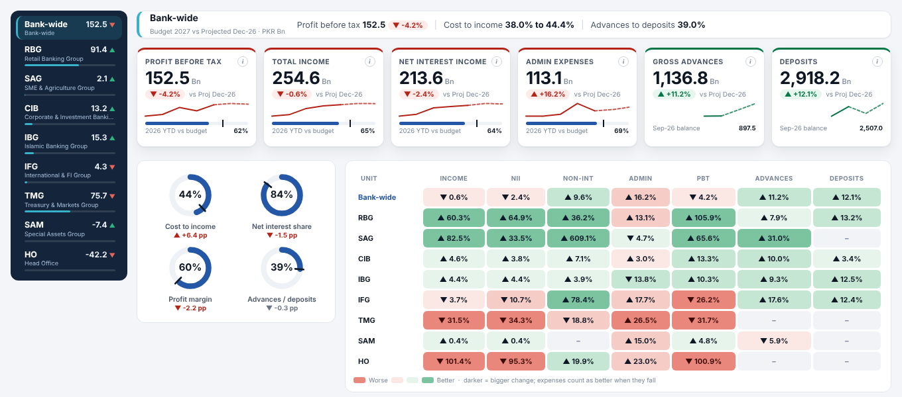
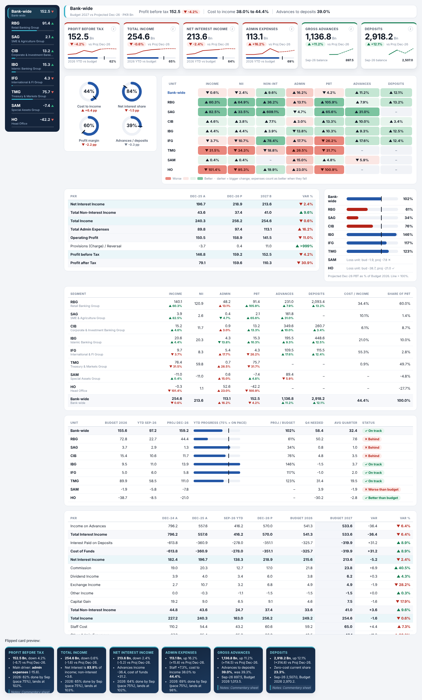
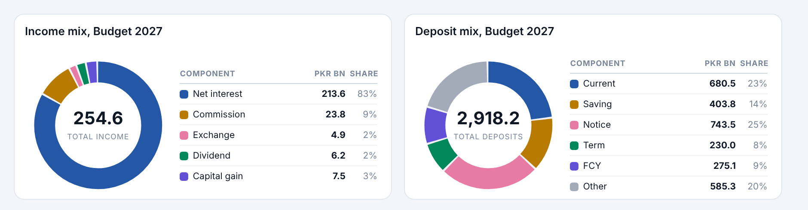
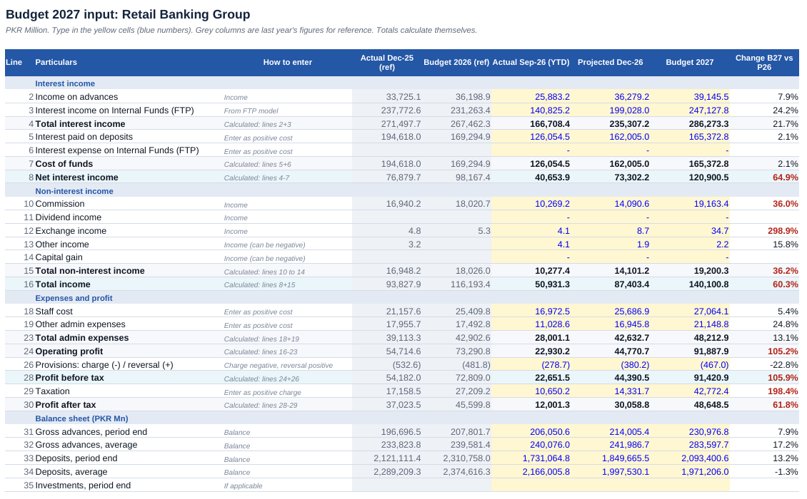

# Demo Bank: Budget 2027 Dashboard (Power BI)

A bank-wide budget dashboard for top management, built in Power BI as a **PBIP project**
(report and model saved as plain text, so every change is tracked in Git).

> **Demo Bank is a fictional bank. All figures are randomly generated sample data.**

**Live report:** _add your Publish to web link here_



<details><summary>More screens</summary>





</details>

## Features

- **Flip KPI cards**: click a card to read the commentary on the back (HTML Content visual, no scripts)
- **Left menu** for Bank-wide and 8 business groups, with PBT and share bar for each
- **Compare to** buttons: Budget 2027 against Projected Dec-26, Budget 2026 or Actual Dec-25
- **Units** buttons: PKR Mn or Bn
- Profit bridge (waterfall), five-year trend, segment contribution, income and deposit mix donuts with value legends
- Variance heatmap, full P&L, segment scorecard, balance sheet and a 2026 tracker
- 212 DAX measures, all blank-safe
- **Group input workbooks**: each group fills its own Excel file, and Power BI merges them on refresh

## Pages

| Page | What it shows |
|---|---|
| Complete View | Everything on one scrolling page |
| Executive Summary | KPIs, profit bridge, trend, ratios, segment contribution |
| Profit & Loss | Full P&L and balance sheet with variance |
| Segment Scorecard | All groups side by side, heatmap |
| Balance Sheet | Advances, deposits, investments, borrowings and product mix |
| Budget 2026 Tracker | Sep-26 YTD progress against budget |

## Business units

| Code | Unit |
|---|---|
| RBG | Retail Banking Group |
| SAG | SME & Agriculture Group |
| CIB | Corporate & Investment Banking Group (Core, Debt Capital Markets, Investment Banking) |
| IBG | Islamic Banking Group |
| IFG | International & FI Group |
| TMG | Treasury & Markets Group (Capital Markets, Money Market, FX) |
| SAM | Special Assets Group |
| HO | Head Office |

## Data model (star schema)

```
Dim_Unit ───┐                  ┌─ Dim_Product
Dim_Line ───┼── Fact_PL         │
Dim_Period ─┴── Fact_Portfolio ─┘
                Fact_Commentary (card notes)
```

| Table | Content |
|---|---|
| Fact_PL | Amount by unit, P&L line and period |
| Fact_Portfolio | Advances and deposits by product |
| Fact_Commentary | Notes shown on the back of the KPI cards |
| Dim_Unit / Dim_Line / Dim_Period / Dim_Product | Lookup tables |
| Unit Selector, Compare Period, Scale, Bridge Steps, Tracker Line, Income Mix | Helper tables for the menu, buttons and charts |

The sample data is fully consistent: P&L subtotals add up, each group equals its sub-units,
Bank-wide equals the sum of the 8 groups, and products add up to the group balances.
The `Data_Checks` sheet in the Excel file shows OK in every cell.

## Repository layout

```
DemoBank_Budget2027/                 Power BI project (open the .pbip file)
  DemoBank_Budget2027.Report/        Pages and visuals (PBIR JSON)
  DemoBank_Budget2027.SemanticModel/ Tables, relationships and DAX (TMDL)
DemoBank_Budget2027_DataModel.xlsx   Main data source
Group_Templates/                     Input workbooks to send to each group
Sample_Inputs/                       Filled examples of the group workbooks
Inputs/                              Put returned group files here
Blank_Layouts/                       Page layouts with every visual labelled
Budget2027_DAX_Measures.dax          All measures as text
SETUP.txt                            Step-by-step setup and use
docs/                                Web page for GitHub Pages
```

## Open it

1. Install the latest **Power BI Desktop**.
2. Download this repo (Code > Download ZIP) and unzip it to `E:\Budget2027\`.
   Another folder? In Power BI: Transform data > Edit parameters > **DataFile** and **InputFolder**.
3. Open `DemoBank_Budget2027\DemoBank_Budget2027.pbip`.
4. If asked for the **HTML Content (lite)** visual: Insert > More visuals > From AppSource > add it.
5. Home > **Refresh**.

## Tools

Power BI Desktop (PBIP, PBIR, TMDL), DAX, Power Query (M), HTML Content (lite) certified visual, Excel.

## Author

**Yasir Ilyas Malik**, Business Analytics & FP&A
